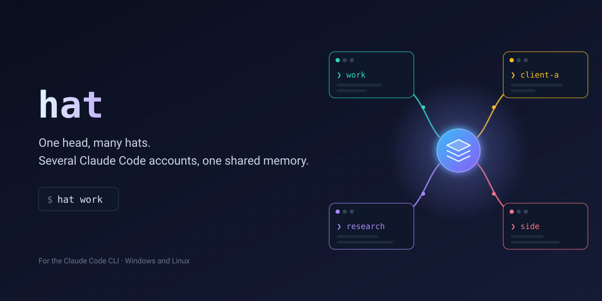

<p align="center"></p>

Claude Code signs in one account per config folder. If you have a second account, you either sign out and back in every time you switch, or you give it a fresh folder that shares nothing: no instructions, no skills, no memory, no history.

hat gives each account its own folder that holds only its sign-in. Everything else links back to your main `~/.claude`, so `hat work` and plain `claude` run side by side with the same instructions, settings, skills, plugins, memory, and history. This is the multi-account setup Anthropic describes under [Log in with multiple accounts](https://code.claude.com/docs/en/authentication#log-in-with-multiple-accounts), packaged so the shared parts stay shared.

Not affiliated with Anthropic. Claude and Claude Code are trademarks of Anthropic, PBC.

## Who it's for

hat is for people who hold more than one legitimate account, such as a work seat and a personal plan, or seats at two clients. It isn't for sharing an account with someone else, or for pooling accounts to get around usage limits. Anthropic's terms and your employer's policies apply to every account you run with hat.

## Before you install

- The native Claude Code install, from [Claude Code setup](https://code.claude.com/docs/en/setup). On Windows, hat refuses to run the npm install's `claude.cmd`, because arguments passed through `cmd.exe` could run commands.
- Windows or Linux. macOS isn't supported yet; see [Limits](#limits).
- On Windows, Developer Mode, so hat can link files between accounts. Turn it on in Settings > System > For developers. Folders use junctions, which need nothing.

## Install

Linux:

```sh
curl -fsSL https://raw.githubusercontent.com/yavuz-ozkan/hat/main/install.sh | sh
```

Windows, in PowerShell:

```powershell
irm https://raw.githubusercontent.com/yavuz-ozkan/hat/main/install.ps1 | iex
```

Both put `hat` in `~/.local/bin`, check the download against the release's `checksums.txt`, and print the line to add if that folder isn't on your PATH yet.

To install a specific release, for instance to roll back, set `HAT_VERSION`:

```sh
curl -fsSL https://raw.githubusercontent.com/yavuz-ozkan/hat/main/install.sh | HAT_VERSION=0.1.0 sh
```

```powershell
$env:HAT_VERSION = '0.1.0'; irm https://raw.githubusercontent.com/yavuz-ozkan/hat/main/install.ps1 | iex
```

`HAT_BIN_DIR` installs somewhere other than `~/.local/bin`.

With Go 1.26 or newer, you can build it instead:

```sh
go install github.com/yavuz-ozkan/hat@latest
```

After that, `hat upgrade` installs each new release in place.

## Commands

```
hat work                     start Claude as the work account
hat work --resume            any Claude arguments pass straight through
hat usage                    every account's plan limits on one screen
hat usage --json             the same, for scripts and agents
hat usage --live             ask Anthropic right now (unofficial, see below)
hat statusline               record plan limits for hat usage (set as your status line)
hat rm work                  delete an account hat made
hat upgrade                  install the newest release
hat version                  show the installed version
```

Account names use lowercase letters, digits, and dashes, like `work` or `client-a`. Plain `claude` stays your main account.

## How it works

Claude Code reads its config from `~/.claude`, or from the folder `CLAUDE_CONFIG_DIR` names. hat gives each account the folder `~/.claude-<account>` and, on every start:

1. Links the shared items in that folder back to `~/.claude`: `CLAUDE.md`, `settings.json`, `settings.local.json`, `history.jsonl`, `skills`, `agents`, `commands`, `output-styles`, `plugins`, `projects` (which holds memory), and `file-history`.
2. Copies your main account's connector list into the account. Main's version wins for a connector both have. You sign in to each connector once per account.
3. Points Claude's memory straight at the main folder for the project you start in. Without this, Claude asks before every memory write, because the shared folder is reached through a link.
4. Gives the account its own agent-browser session and saved website logins, so accounts browsing at the same time don't share a browser.
5. Signs the account in on its first run, then starts Claude with `CLAUDE_CONFIG_DIR` set.

If Claude replaces a link with a real file or folder while saving, hat warns you on the next start and tells you how to merge it back. It never overwrites the copy.

`~/.claude-*` folders hat didn't make, such as a personal account you keep separate on purpose, show up in `hat usage` and are otherwise left alone.

## What it touches

- hat never writes to `~/.claude`, `~/.claude.json`, or a `~/.claude-*` folder it didn't make. A folder counts as hat's if it holds hat's `.hat` marker (or `.claude-as`, from before the rename), or if its `CLAUDE.md` links to main's.
- New account folders are readable only by you (mode 0700 on Linux).
- `hat rm` deletes the account's folder: its sign-in, connector sign-ins, and saved browser logins. It never deletes what the links point at. Your shared memory, settings, and skills stay in `~/.claude`.
- `hat usage` and `hat statusline` never read a token and send nothing anywhere.
- `hat usage --live` reads each account's sign-in token and sends it only to `api.anthropic.com`. It never prints or logs the token, and never follows a redirect elsewhere.
- hat never renews a sign-in itself. When `--live` finds an expired one, it runs `claude mcp list` as that account and Claude renews it. Two programs renewing the same sign-in sign each other out.
- hat keeps its own files in two places: settings in `%APPDATA%\hat` on Windows or `~/.config/hat` on Linux, and recorded usage in `%LOCALAPPDATA%\hat` or `~/.cache/hat`.

## Usage and the status line

`hat usage` shows each account's 5-hour and weekly limits, and how old the numbers are. It reads them from the status line: Claude Code hands its status line command a documented `rate_limits` object, and `hat statusline` saves it per account before printing your line.

To start recording, add this to `~/.claude/settings.json`:

```json
{
  "statusLine": { "type": "command", "command": "hat statusline" }
}
```

hat never edits `settings.json` for you. Because accounts share main's `settings.json`, this one setting covers main and every account hat made. A folder you keep separate needs it in its own `settings.json`.

With no command after it, `hat statusline` prints a short line like `Opus · 5h 23% · week 41%`. To keep your own status line, put `hat statusline` in front of the command you already have:

```json
{
  "statusLine": { "type": "command", "command": "hat statusline ~/.claude/statusline.sh" }
}
```

hat passes your command the same input, prints what it prints, and exits with its exit code. It runs your command directly, not through a shell, so wrap a shell snippet with pipes or `&&` as `hat statusline sh -c '...'`. On Windows, write paths with forward slashes, as Claude Code's [status line docs](https://code.claude.com/docs/en/statusline) explain.

Claude Code sends `rate_limits` only for Pro, Max, and Ultra plans, and only after the first answer in a session. Until an account has used Claude with the status line set, `hat usage` says how to start recording for it. A window whose reset time has passed is left out, as Claude Code does.

### `--live` is unofficial

`hat usage --live` asks Anthropic for the numbers right now, through the endpoint behind Claude Code's own `/usage` screen. That endpoint is undocumented, so it may change or stop working at any time. When it does, `--live` says so, and plain `hat usage` keeps working.

`hat usage --json` and `hat usage --live --json` print the same shape. Each row has `account`, `kind`, `email`, `limits`, `asOf`, and, when something's wrong, a `problem` with a stable `code`: `not_signed_in`, `no_usage_recorded`, `sign_in_expired`, `sign_in_rejected`, `rate_limited`, `unreachable`, or `unexpected_response`.

## Sharing more

To share more of the main folder, such as files a skill keeps there, list them in `config.json` in hat's settings folder (`%APPDATA%\hat\config.json` on Windows, `~/.config/hat/config.json` on Linux):

```json
{ "alsoShare": ["my-skill-data", "my-skill-state.json"] }
```

Each entry is a file or folder name directly inside `~/.claude`. The next start of each account links them. hat refuses names that hold a single account's sign-in or state.

## Uninstall

1. Run `hat rm <account>` for each account you made. Your shared files stay in `~/.claude`.
2. Remove the `statusLine` entry from `~/.claude/settings.json`, or take `hat statusline` off the front of your own command.
3. Delete the program: `~/.local/bin/hat`, or `~\.local\bin\hat.exe` on Windows.
4. Delete hat's own folders: `~/.config/hat` and `~/.cache/hat` on Linux, `%APPDATA%\hat` and `%LOCALAPPDATA%\hat` on Windows.

## Limits

- Only the Claude Code CLI reads per-account folders. The desktop app and IDE extensions always use the main account.
- The Claude in Chrome extension is signed in to one account at a time. Use agent-browser for browser work in several accounts at once.
- The memory folder name copies Claude Code's own naming rule. If a Claude Code update changes that rule, accounts start a fresh memory for a project instead of sharing main's until hat catches up.
- No macOS yet. Claude Code keeps macOS sign-ins in the Keychain rather than in the config folder, so hat's per-folder model needs more work there.

## Maintaining

Releases are tags. Push a tag like `v0.2.0` and the Release workflow tests it, builds Windows and Linux for Intel/AMD and ARM, publishes the archives with `checksums.txt`, and attests their build provenance. A tag like `v0.2.0-rc.1` becomes a pre-release, which installers and `hat upgrade` skip.

To check that an archive was built by this repository's workflow:

```sh
gh attestation verify hat_0.2.0_linux_amd64.tar.gz --repo yavuz-ozkan/hat
```

To build from source, run `go build -o hat .` with Go 1.26 or newer. [REVIEW.md](REVIEW.md) lists what a change must not break.

## License

MIT. See [LICENSE](LICENSE).

